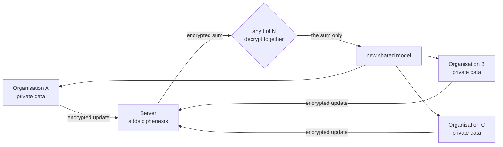

# Horizon

[](https://github.com/4uhn/Meta-AI-Hackathon/actions/workflows/test.yml)
[](LICENSE)

**A framework for organisations that cannot share their data to fine-tune AI models together,
without anyone, including the aggregation server, ever seeing a single organisation's
contribution.**

Horizon combines federated fine-tuning of LLMs with threshold-encrypted aggregation:
- each organisation fine-tunes an open-weight model, such as Meta's **Muse Glimmer**, on its own
  private data
- it encrypts its model update before the update leaves
- the server adds up the encrypted updates without being able to read them
- only the **sum** can be decrypted, and only when any t of the N organisations cooperate

Unlike general-purpose federated-learning frameworks such as Flower (shoutout!), Horizon is a
specialist: it is built for competing organisations in regulated industries such as telecoms and
healthcare, and it is encrypted by default.

▶ **[Watch the 3-minute video](https://youtu.be/1QLFcgaifCU)**

## Results

**Model:** Muse Glimmer-30B (4-bit, LoRA) · **Trained on:** Modal (L40S GPUs) · **Metric:**
macro-F1 on a held-out test set

| Task | Organisations | Horizon (encrypted) | All data pooled | Source |
|---|---|---|---|---|
| 5G intrusion detection | 3 mobile operators | **0.949** | 0.955 | [`5g-nidd-glimmer/`](results/5g-nidd-glimmer/) |
| Aviation safety reports (NASA ASRS) | airline, air traffic control, general aviation | **0.910** | 0.899 | [`asrs-glimmer/`](results/asrs-glimmer/) |
| Aviation safety reports, 3-of-4 | the three above + business aviation | **0.905** | – | [`asrs4-glimmer/`](results/asrs4-glimmer/) |

Some extra cool stats:
- **5G:** recall on attack types an operator never saw in its own traffic rose from **0.000**
  training alone to **0.943** with Horizon
- **Aviation:** air traffic control's recall on loss-of-control events rose from **0.08**
  training alone to **0.92** with Horizon

Encryption costs no accuracy: replaying the plaintext reference run's updates through the encrypted
path gives the same aggregate to within 2.14e-6 per value, and identical predictions on all 998 test
rows ([`equivalence.json`](results/5g-nidd-glimmer/equivalence.json)).

We also measured what a server could learn without encryption. We saw that one plaintext update
reveals which attack types its owner holds (AUC 0.993), while the decrypted sum does not (0.508).
See [docs/why-encrypt.md](docs/why-encrypt.md).

Scores can vary between runs on different GPU models, because bf16 training is not bit-reproducible
across hardware (our Llama rerun scored 0.882 against 0.930: [`5g-nidd-llama-rerun/`](results/5g-nidd-llama-rerun/)).

## Try it

```bash
git clone https://github.com/4uhn/Meta-AI-Hackathon.git horizon && cd horizon
make setup && make he                                    # Python 3.12 (or PYTHON=python3.11), Go ≥ 1.24
.venv/bin/python examples/federated-fine-tuning/run.py   # CPU only, about a minute, no account
```

This downloads the 5G dataset (sha256-checked), splits it across three operators, and runs the
full encrypted federated loop with a tiny model. Each round:
- three operators encrypt their updates
- the server sums them
- two operators decrypt the sum
- one share alone gives noise

`make doctor` checks your setup and prints the next step.

## How it works



*Figure 1. One training round.*

1. **Setup, without a trusted dealer.** Each organisation makes its own secret key and gives the
   others Shamir shares of it, so the collective secret key never exists anywhere.
2. **Train.** FFA-LoRA: the LoRA A matrices stay frozen at a shared seed and only B trains, so
   averaging B is exact. For Glimmer-30B, B is 4.7 million numbers.
3. **Encrypt and sign.** Each update is encrypted with CKKS (Lattigo v6; ≥ 128-bit security) under
   the collective key and signed. That is 150.6 MB of ciphertext per organisation per round.
4. **Sum.** The server adds the ciphertexts, and that is all it does: it holds no key share.
5. **Decrypt the sum, once.** t organisations each recompute the sum from the signed updates, then
   release one decryption share, flooded with noise. Each first checks two rules:
   - the sum must have at least t + 1 contributors
   - one share per round, because a second decryption could leak key material or let someone
     subtract two different sums

Details: [docs/how-it-works.md](docs/how-it-works.md). The crypto layer works on its own for any
vector, in any FL system: [examples/secure-aggregation](examples/secure-aggregation/).

## Threat model and limits

We want Horizon to foster collaboration between organisations, and that collaboration is built on
trust: Horizon assumes every organisation follows the protocol and that fewer than t of them
collude.

Protected:
- each organisation's individual update, from the server and from up to t − 1 colluding
  organisations
- the protocol's refusals (fake aggregates, too-small sums, replays, repeated decryptions), tested
  at full payload size

Not covered:
- the trained model is shared with every member. Membership inference measured AUC 0.505 on
  5G-NIDD (chance) and 0.541 on the aviation reports (at most a small signal)
- formal differential privacy is not included yet. It is in development as an add-on, where each
  organisation adds calibrated noise before encrypting

Full threat model: [SECURITY.md](SECURITY.md).

## Choose your t-of-N

```bash
make check-tofn PARTIES=5 THRESHOLD=4    # rules, parameters, then the full selftest at Glimmer size
```

Verified at 4.7M values per update ([`results/crypto/scaling.json`](results/crypto/scaling.json)):
2-of-3, 3-of-4, 3-of-5 and 4-of-5. 3 ≤ N ≤ 5 is supported. For N = 6 or 7, add `UNVERIFIED=1` and
verify the results yourself first; beyond 7 you need new CKKS parameters.

Guide: [crypto/README.md](crypto/README.md#choosing-t-of-n).

## Run it yourself

| Run | Command | Needs |
|---|---|---|
| tiny model on your CPU | `python examples/federated-fine-tuning/run.py` | nothing |
| tiny model in Modal containers | `… --on modal --model tiny` | a Modal account |
| Llama-3.2-1B on Modal GPUs | `… --on modal --model llama` | Modal and a Hugging Face token (Llama is gated) |
| Muse Glimmer-30B on Modal GPUs | `… --on modal --model glimmer` | a Modal account (Glimmer is not gated) |

To set up Modal, follow [docs/run-on-modal.md](docs/run-on-modal.md): signing in, the optional
Hugging Face token, and what each run costs. Your apps and volumes are named with your own prefix
(`HORIZON_MODAL_PREFIX`), and every GPU launch asks before it starts.

To use your own data, with no code changes, see
[docs/bring-your-own-data.md](docs/bring-your-own-data.md) and the
[custom-dataset example](examples/custom-dataset/).

Every number above, the file it comes from and the command that reproduces it can be found here:
[results/README.md](results/README.md#reproduce-the-headline-numbers).

## Built during the hackathon

All code was written during the Meta Global AI Developer Hackathon, 26 Oct – 4 Nov 2026. The one
earlier commit (25 Oct) is GitHub's repository creation: a one-line README.

## Acknowledgements

- **Muse Glimmer-30B**, Meta, Apache-2.0 (`meta-models/Muse-Glimmer-30B`; 4-bit checkpoint
  `unsloth/Muse-Glimmer-30B-unsloth-bnb-4bit`). Development model: **Llama-3.2-1B-Instruct**, Llama
  3.2 Community License.
- **5G-NIDD**, CC BY 4.0: Siriwardhana et al., IEEE Data Descriptions 2 (2025) 358–369,
  doi:10.1109/IEEEDATA.2025.3592888 (arXiv:2212.01298); dataset
  doi:10.23729/e80ac9df-d9fb-47e7-8d0d-01384a415361.
- **NASA Aviation Safety Reporting System** (ASRS), a US Government work, via the Hugging Face
  mirror `sookiemonster/asrs-narratives` (pinned revision).
- **Lattigo v6** (Apache-2.0, Tune Insight), **PEFT** and **Transformers** (Apache-2.0, Hugging
  Face), **Modal** for GPUs.

## Licence

Apache-2.0 ([LICENSE](LICENSE)).

## Citation

If you use Horizon in your work, please cite it:

```bibtex
@software{chau2026horizon,
  author = {Chau, Jacob},
  title  = {Horizon: Federated {LoRA} Fine-Tuning with t-of-{N} Threshold-Encrypted Aggregation},
  year   = {2026},
  url    = {https://github.com/4uhn/Meta-AI-Hackathon},
  note   = {Version 0.1.0}
}
```
