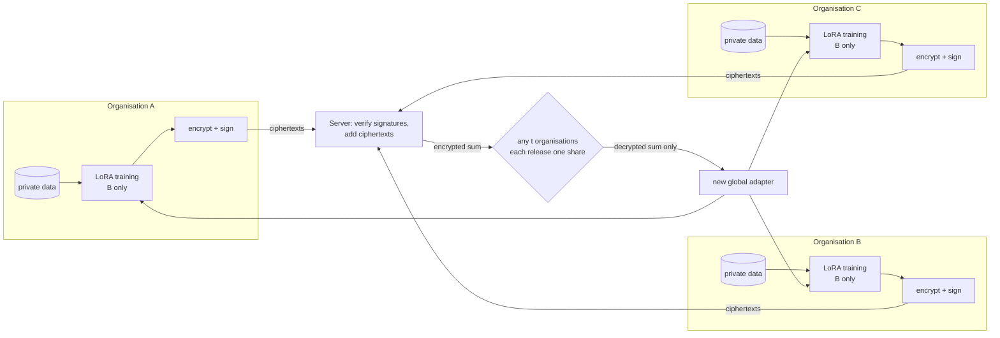

# How Horizon works

N organisations fine-tune one open-weight LLM together for a classification task. None of them shares
its data, and none of them, nor the server, can decrypt another's model update.



## 1. Setup, once per consortium (no trusted dealer)

Each organisation:
1. creates its own CKKS secret key and an Ed25519 signing key;
2. publishes a public-key share;
3. sends each other organisation a Shamir share of its secret key, privately;
4. combines the shares it received into its threshold key share, and erases its original key.

The server combines the public shares into one collective public key. The full secret key never
exists anywhere. Any t threshold shares can decrypt together; fewer cannot.

## 2. Each round

1. **Train locally.** Every organisation starts from the same global adapter and trains on its own
   data. With FFA-LoRA, the LoRA A matrices stay frozen at a shared seed and only the B matrices
   train, so the average of the B updates is exactly the update of the average model. For Muse
   Glimmer-30B that is 4,685,824 numbers per organisation, plus one weight (4,685,825 values per
   submission).
2. **Encrypt.** The organisation flattens B, weights it by its data size, encrypts it under the
   collective key, and signs a statement binding the ciphertext's hash to the run, round, parameters
   and public key. Only ciphertext and the statement leave the organisation.
3. **Aggregate.** The server checks the signatures and adds the ciphertexts. This is addition only,
   so no evaluation keys are needed. It holds no key share and sees no plaintext.
4. **Decrypt the sum, once.** The server names t organisations. Each one:
   - recomputes the sum from the signed submissions itself;
   - checks the rules (≥ t + 1 contributors, one share per round);
   - releases a decryption share, flooded with fresh noise so it reveals nothing about its key.

   The server combines the t shares into the decrypted sum and divides by the total weight.
5. **Next round.** The new B goes back to every organisation.

If an organisation misses a round, the sum is decrypted only if t + 1 contributors remain;
otherwise the round is skipped and the adapter carries over. Up to N − t organisations can be
offline at decryption time.

## 3. Who sees what

| | Its own data | Its own update | Another's update | The decrypted sum | The final model |
|---|---|---|---|---|---|
| Organisation | yes | yes | no | yes | yes |
| Server | no | no | no (ciphertext only) | yes | yes |
| Any t − 1 colluding organisations | their own | their own | no: at most a sum of ≥ 2 others | yes | yes |

**Compared with shared-key encryption.** Some federated setups encrypt updates under one key that
every client holds. For example, NVIDIA FLARE's homomorphic-encryption provisioning creates one
TenSEAL context and writes its secret key into every client's kit
([`nvflare/lighter/impl/he.py`](https://github.com/NVIDIA/NVFlare/blob/main/nvflare/lighter/impl/he.py)).
That hides updates from the server, but any client can decrypt any other client's update. In
Horizon no one holds the whole key: decryption needs t organisations, and it yields only sums.

Limits, and what this does not protect: `SECURITY.md`.

## 4. The run directory: how the parties connect

The reference implementation connects parties through files: one run directory acts as the message
bus. Every protocol step is a separate process acting as exactly one party, and a path guard refuses
any access to another party's private area.

```
runs/<run>/
  public/                 params.json, parties.json, crs_seed, pk.bin, sign_<op>.pub   (everyone reads)
  parties/<op>/secret/    the operator's threshold key share and signing key           (that operator only)
  parties/<op>/state/     decrypt_log.jsonl (one share per round), staged plaintext (deleted after encryption)
  bus/setup/, bus/private/<op>/   public-key shares; Shamir shares addressed to <op>   (inbox: <op> only)
  bus/round_<r>/
    global/               the adapter everyone trains from this round                  (server writes)
    submissions/<op>/     ct.bin + statement.json, signed                              (operator writes)
    aggregate/            ct_agg.bin + aggregate.json (contributors)                   (server writes)
    decrypt/              request.json (who decrypts); decshare_<op>.bin (operators); agg.f64 (server)
  events.jsonl            one structured event per step (what happened, by whom, when)
```

**To deploy across real organisations**, replace the shared directory with a transport you trust,
such as per-organisation object storage or an authenticated API. Move the same files between the
same parties:

- `public/` and `bus/` contents are exchanged;
- `parties/<op>/` never leaves organisation `<op>`;
- `bus/private/<op>/` goes only to `<op>`, over an encrypted channel.

The command each party runs stays the same (`crypto/README.md`).

In this reference setup, one machine simulates every organisation's key-holding side, each in its own
directory and process. On Modal, each organisation's training runs in its own container, which
mounts only that organisation's data volume and receives only its own signing key. In a real
deployment each organisation runs its steps on its own infrastructure.

## 5. Where the code is

| Path | What it holds |
|---|---|
| `crypto/` | `horizon-he`: threshold CKKS, the protocol rules, the path guard |
| `horizon/fl/` | the round loop (`run.py`), operator (`operator.py`), aggregator (`aggregator.py`), evaluation |
| `horizon/model/` | LoRA set-up and flattening, training, label scoring |
| `horizon/he_bridge.py` | the Python wrapper: one `horizon-he` process per party step |
| `modal_app/` | the Modal backend: one isolated container per model step |
