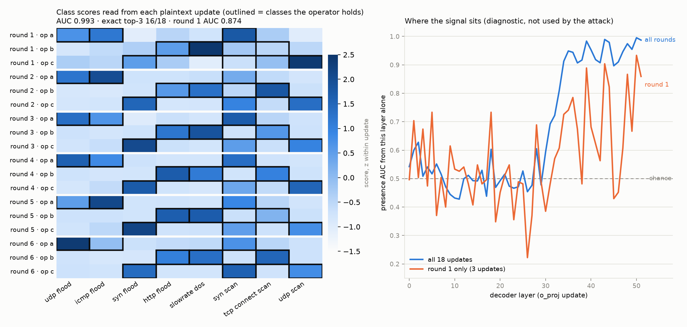

# Why encrypt: what one model update reveals

Federated learning keeps the raw data at home, but each organisation still sends a model update.
This page measures how much a curious server could learn from one unencrypted update, and checks
that the sum Horizon actually decrypts does not leak the same thing.

## Setup

- 18 plaintext updates from a reference run on 5G-NIDD with Muse Glimmer-30B: 3 operators × 6
  rounds. They come from the `--insecure-reference` path, which exists for experiments and is
  never used by Horizon's encrypted path.
- The attacker is the server, and it uses only public information: the base weights and the frozen
  LoRA A matrices.
- The question: which attack types does each operator hold in its private data?

## Results

**One update gives away its owner's data.** Projecting an update onto each label's output
direction (a "logit lens": no data and no GPU needed) ranks the attack types an operator holds
above the ones it lacks:
- presence AUC **0.993** over the 18 updates (0.874 from round 1 alone)
- the top 3 exactly right for **16 of 18** updates
- exact permutation test p = 1/1680, the smallest possible
- a shuffled-block null gives 0.49 [0.41, 0.59]

**The decrypted sum does not.** The same attack on the aggregate that Horizon decrypts scores
**0.508** and gets 0 of 18 right.

**A second attack agrees.** Gradient matching also recovers the classes: AUC 0.835 centred, 0.924
raw.

**The leak is not caused by our training setup.** With the restricted softmax turned off, the
round-1 attack still scores 0.822.

So without encryption, sharing a model update shares a summary of your private data. Horizon's
encryption removes it: the server only ever sees ciphertexts and the sum.

## Files and commands

| Result | File | Command |
|---|---|---|
| logit lens, null, decrypted-sum control | `results/5g-nidd-glimmer/update_leakage.json`, `.png` | `python -m horizon.eval.update_leakage --run <plaintext-reference run> --partition configs/partitions/5g-nidd.yaml` (CPU) |
| gradient matching | `results/5g-nidd-glimmer/update_leakage_probe.json` | `python -m modal_app.leakage probe --ref-run <plaintext-reference run>` |
| restricted softmax off | `results/5g-nidd-glimmer/update_leakage_ablation.json` | `python -m modal_app.leakage ablation --ref-run <plaintext-reference run>` (config `configs/5g-nidd-glimmer-no-restriction.yaml`) |

To make a plaintext-reference run, use `examples/federated-fine-tuning/run.py --on modal --model glimmer
--plaintext-reference`; it writes the run to `runs/examples/5g-nidd-glimmer/runs/5g-nidd-glimmer_E2`.
